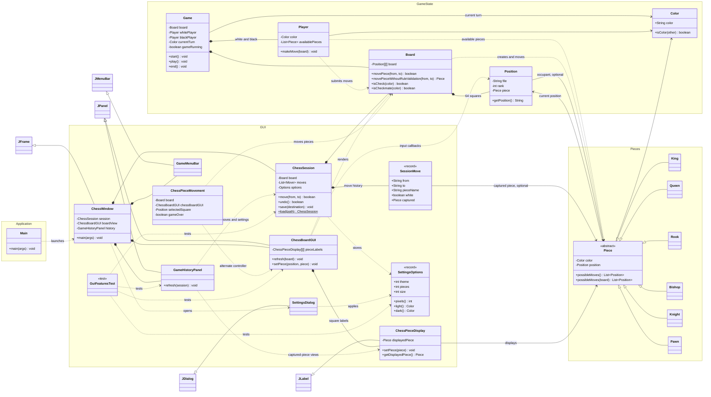

# Class diagram

The diagram shows the main application classes and their relationships.
The current GUI flow is centered on `ChessWindow` and `ChessSession`; the
console `Game` model and `ChessPieceMovement` controller are separate
implementations.

`SessionMove` represents the nested `ChessSession.Move` record, and
`SettingsOptions` represents `SettingsDialog.Options`. `ChessPieceMovement`
is an alternate controller; the current window handles moves through
`ChessSession`.
